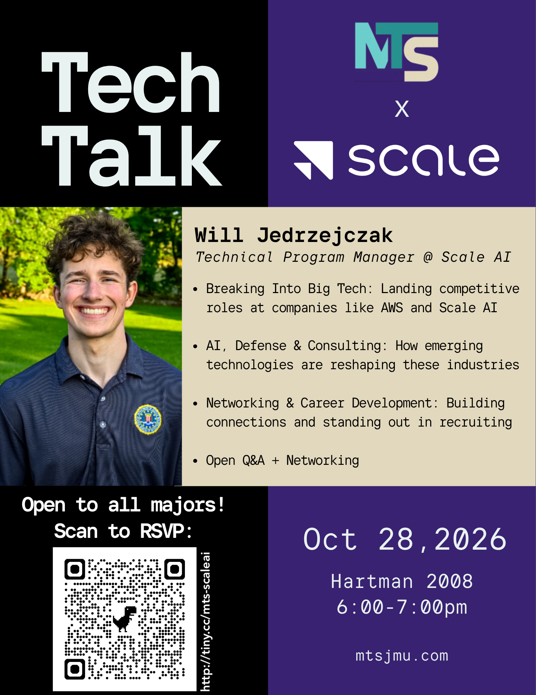

Madison Tech Society (MTS) x Scale AI present a Tech Talk with **Will Jedrzejczak**, Technical Program Manager @ Scale AI.
**Open to all majors!**

## Topics

- **Breaking Into Big Tech:** Landing competitive roles at companies like AWS and Scale AI
- **AI, Defense & Consulting:** How emerging technologies are reshaping these industries
- **Networking & Career Development:** Building connections and standing out in recruiting
- Open Q&A + Networking

## Details

- Wednesday, Oct. 28
- 6:00 pm to 7:00 pm
- 2008 Hartman Hall

**[RSVP here](http://tiny.cc/mts-scaleai)** or scan the QR code on the flyer below. More at [mtsjmu.com](https://mtsjmu.com).

---

